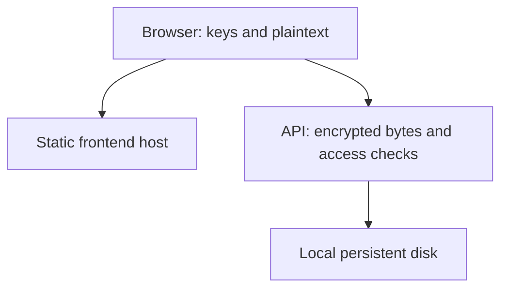

# Nullbin threat model

Nullbin is a zero-knowledge encrypted pastebin. This document lists what it
protects, from whom, how, and what it does not protect against. The
repository is public, so nothing here relies on the code being secret.

## 1. System and trust boundaries

The default Compose layout puts the static frontend/TLS proxy and the API
in separate containers on one host. Only `/api/v1/` is proxied to the API;
other pages/assets come from the frontend image. API responses receive a
sandboxed CSP at the proxy, with Set-Cookie and Service-Worker-Allowed
removed. The API has only its data volume and cannot write the frontend.
A whole-host compromise can affect both containers.

The separate-host option publishes the static frontend independently. Its
API origin is fixed at build time. The API grants CORS to exactly one
configured frontend origin and still requires all capability tokens. A
backend-host compromise cannot change the frontend if its hosting, DNS and
publishing credentials remain outside that host's control. The optional
combined binary retains the original single-process trust boundary.

| Component | Trust |
|---|---|
| Sender and recipient browsers | Trusted to run the served JavaScript faithfully. Hold keys and plaintext. |
| URL fragment (`#key`) | Secret. Shared out of band by the sender. Never sent over HTTP by browsers. |
| Static frontend host and publishing account | Trusted to serve the correct HTML, JavaScript, styles and security headers. Holds no paste data. See R1. |
| Nullbin API process | Not trusted with content. Trusted for availability, metadata handling, expiry and configured burn-read limits. Does not serve frontend files in API-only mode. |
| Reverse proxy / TLS terminator | Sees IPs, IDs, tokens in headers and ciphertext. In the one-host layout it also protects frontend routing and API response isolation. |
| Data directory | Not trusted with content. Holds ciphertext and minimal metadata. |
| CI, dependencies, base images | Supply chain. Pinned and reviewed, but trusted for released builds. |

## 2. Assets

1. **Paste content**: text, file bytes, filename, MIME type, and comments in a discussion (text, name, which comment replies to which). Must stay confidential and unmodified.
2. **Keys and passwords**: fragment key, password, derived key.
3. **Capability tokens**: upload token (until finalize), delete token.
4. **Metadata**: paste ID, ciphertext size, creation and expiry times, burn flag, configured open limit and used opens, client IP, timing.
5. **Integrity of the served frontend code**: the JS and CSS that do the crypto.
6. **Availability**: disk, memory, connections, CPU.

## 3. Adversaries

| ID | Adversary | Capabilities |
|---|---|---|
| A1 | Passive network observer | Sees traffic. TLS is expected in front of Nullbin. |
| A2 | Anonymous internet client | Sends arbitrary HTTP requests. Knows all the source code. |
| A3 | Storage attacker | Reads (or later steals) the data directory, backups or snapshots. |
| A4 | Honest-but-curious operator | Reads server memory, logs and disk, but serves the genuine code. |
| A5 | Malicious operator or compromised server | Can change the server and serve any JavaScript. |
| A6 | Link observer | Sees a paste URL somewhere (chat logs, history, screenshots). |
| A7 | Malicious paste author | Crafts a blob or content aimed at the viewer's browser. |
| A8 | Supply-chain attacker | Compromises an npm/Go dependency, a GitHub Action, a base image, or a maintainer account. |

## 4. Security goals

- **G1 Confidentiality**: the server, storage and network (A1–A4) never learn content, comments, keys, passwords, filenames or MIME types.
- **G2 Integrity**: any modification, truncation, reordering or extension of a blob is detected, and the viewer shows nothing from the modified part.
- **G3 Minimal metadata**: the server stores only `id`, `created_at`, `expires_at`, `burn_after_reading`, ciphertext size and the SHA-256 of the delete token; for a burn paste, also the SHA-256 of its burn-access token and, when configured above one open, `read_limit` and `reads_used`; for a paste with a discussion, also the SHA-256 of the comment token and the encrypted comments in arrival order. IPs exist only in memory, hashed, for rate limiting.
- **G4 Burn-after-reading**: at most the configured number of authenticated POSTs receive a burn paste's ciphertext (default one; configurable from 1 to 1,000). Interrupted authorized transfers consume an open. Wrong tokens/passwords and prefix/GET/HEAD requests do not.
- **G5 Expiry**: expired pastes are never served and are deleted promptly.
- **G6 Capability control**: only holders of the upload token can write a pending paste; only holders of the delete token can delete; only readers who know the link key and any password can consume a burn paste or read/post comments.
- **G7 Viewer safety**: decrypted content is never interpreted as HTML or script and never previewed inline.
- **G8 Robustness**: a single client cannot exhaust the server's memory, disk or connections cheaply, or escape the data directory.
- **G9 Verifiability**: anyone can rebuild a release bit for bit and check that a running instance serves the released bundles.

Non-goals: anonymity of senders and recipients toward the operator or network (use Tor if needed), protection against a malicious operator who serves targeted malicious JavaScript (see R1), protection against compromised endpoints, and multi-node deployments.

## 5. Threats and mitigations

### Confidentiality (G1)

| Threat | Mitigation |
|---|---|
| Server reads content | Encryption happens only in the browser with libsodium `crypto_secretstream_xchacha20poly1305`. The server only receives ciphertext. |
| Server learns the key | The key is 32 random bytes from libsodium's CSPRNG, carried in the URL fragment, which browsers do not send. The fragment is removed from the address bar with `history.replaceState` after it is read. |
| Key leaks through `Referer` | `Referrer-Policy: no-referrer` header plus `<meta name="referrer">`. Browsers never include fragments in `Referer` anyway. |
| Weak password brute force on stolen ciphertext | A password is optional and adds to the random key; it never replaces it. Final key = BLAKE2b keyed with the fragment key over Argon2id(password, 16-byte random salt) with `OPSLIMIT_MODERATE`/`MEMLIMIT_MODERATE`. Without the fragment key, a password guess is useless. |
| Filename / MIME / size of the attached file leak | Filename and MIME live inside encrypted frame 1. Only the total ciphertext size is visible (see R2). |
| Logs leak identifiers | No access logs. Errors are logged without paths, IDs, tokens, IPs or user agents; `net/http`'s internal error log is scrubbed of addresses; panics are caught before `net/http` logs the remote address. The bundled Caddy configuration removes request context and response headers from runtime error logs, including custom capability headers. |
| Disk theft reveals tokens | Only SHA-256 hashes of the upload and delete tokens are stored. Tokens are 256-bit random values, so the hash cannot be reversed. The upload-token hash is deleted when the paste is finalized. |

### Integrity (G2, G7)

| Threat | Mitigation |
|---|---|
| Ciphertext modified on disk or in transit | Every frame is authenticated (Poly1305). Frame order is enforced by secretstream. The blob prefix (magic, version, flags, salt) is authenticated as additional data of frame 1. |
| Truncation (drop the last frames) | The last frame must carry `TAG_FINAL`. End of stream before `TAG_FINAL` is an error. Data after `TAG_FINAL` is an error. File length must match the size in the encrypted metadata. |
| Partially verified file reaches the user | With the File System Access API, data is written to a swap file and only committed by `close()` after `TAG_FINAL` is verified; on error the write is aborted. The Blob fallback only creates the download after full verification. |
| Text that looks different from what it contains | Pastes can hold invisible or direction-changing characters ("Trojan Source", CVE-2021-42574) that make code display differently from what copying it yields. The viewer warns when a paste contains them, without changing the text. Nullbin's own source is checked in CI to contain none. |
| XSS from decrypted content | Text is only ever assigned with `textContent`. No `innerHTML` anywhere, and the CSP requires Trusted Types with no policies, so the browser itself refuses HTML-injection sinks if a bug ever adds one. Files are offered only as downloads (`application/octet-stream`), never previewed. The strict CSP blocks inline script even if a bug slipped in. |
| Raw text interprets active content | Raw text opens a local Blob document with the fixed MIME type `text/plain;charset=utf-8` and `noopener noreferrer`; paste text is never inserted into an HTML document. |
| Cloning publishes a partial or corrupted attachment | Only a fully authenticated attachment can enter the new draft. Up to 64 MiB may be retained in browser memory; larger files can reuse a user-saved File handle after successful streaming verification. Cloning does not write plaintext to localStorage, sessionStorage, or IndexedDB. Settings, passwords, and comments are not copied. |
| Sharing leaks a key to a QR service | QR encoding runs locally in the bundled, pinned Nayuki encoder. Email is a user-activated mailto link containing only the full share URL and generic instructions. These intentional sharing actions expose that secret URL to its recipient or the selected email app. |
| Malicious blob crashes or exhausts the viewer | Strict parser: magic, version, unknown flags, non-zero salt without password, frame lengths, metadata size, JSON schema and tags are all validated. Frame sizes are bounded. The default preview is capped at 5,000 lines or 100,000 characters. Copy, Save document, and explicitly requested Raw text retain the full validated text (at most 16 MiB). |
| Server-side MIME sniffing / rendering of ciphertext | Ciphertext is served as `application/octet-stream` with `Content-Disposition: attachment`, `X-Content-Type-Options: nosniff` and `Cross-Origin-Resource-Policy: same-origin`. |

### Discussions (G1, G2, G6, G7)

| Threat | Mitigation |
|---|---|
| Server or storage reads comments | Each comment is sealed with XChaCha20-Poly1305 under a comment key derived (`crypto_kdf`) from the paste's master key, which needs both the link key and the password. A discussion cannot be enabled without a password (enforced when creating, and inside the encrypted metadata, so the server cannot switch it on). |
| Someone who knows only the paste ID (from proxy logs, say) spams or reads comments | The browser derives a separate comment token from the same master key and registers its hash at creation. Reading and posting require the token, so the ID alone is useless, and the server's operator cannot post either. The token reveals nothing about the key. |
| Server forges or alters comments | Forging needs the comment key, which the server never has. Each comment is bound to its paste with additional data (`nullbin comment v1 <id>`); anything that fails to decrypt is hidden, and the reader is told how many were hidden. |
| Thread structure leaks who replied to whom | Comment IDs and parent links are inside the ciphertext. The server stores an ordered list of opaque blobs. |
| Script injection through comments or names | Names and text are shown with `textContent`. Names are stripped of control and bidi characters. |
| Comment flooding fills the disk | Each comment is at most 32 KiB, a discussion holds at most 200, posting is rate limited per client, and comments are deleted with the paste. |
| Discussion on a burn-after-reading paste | Rejected by the browser and by the server. |

### Server-side attacks (G4–G6, G8)

| Threat | Mitigation |
|---|---|
| Path traversal | IDs must match `^[0-9a-f]{32}$` before any filesystem access. All file access goes through `os.Root` opened on the data directory, so even a bug cannot escape it. Paths are built only from constants and validated IDs. |
| ID guessing / enumeration | IDs are 128 bits from `crypto/rand`. Not found, expired and burned all return the same 404. |
| Token guessing or timing attacks | Tokens are 256 bits from `crypto/rand`. Hashes are compared with `crypto/subtle.ConstantTimeCompare`. Wrong token and unknown paste return the same 404. |
| Burn race (concurrent viewers) | One-open pastes retain the atomic directory-rename claim. Multi-open pastes serialize reservations, reload metadata under the lock, and atomically persist the incremented counter before returning ciphertext. Exhausted counters reject further requests even before physical cleanup and after restart. Tests cover 50 concurrent readers competing for one or seven opens. |
| Burn paste consumed by an ID-only request or link preview | Normal API GET/HEAD cannot consume burn pastes. After confirmation, the browser reads only the public 22-byte prefix and derives a separate burn-access token from the master key (KDF context `nbburnac`). The server checks its SHA-256 before reserving an open on POST; untrusted cross-origin browser POSTs are rejected. The token is independent of the encryption key and requires the password when set. Old burn pastes without a token fail closed. |
| Torn writes / crash during upload or publish | Metadata is written to a temp file, fsynced and renamed. Publishing is one atomic directory rename from `pending/` to `pastes/`. Leftover pending and claimed directories are swept. |
| Oversized uploads, disk filling | Max paste size (default 100 MiB, hard ceiling 2 GiB), bounded bodies, ordered chunks of at least 4 MiB (except the last), pending expiry after 2 minutes without progress (1 hour at most) and per-IP limits. A global budget (default 10 GiB) charges filesystem/metadata overhead when an upload starts, each chunk before it is written, and discussion capacity on publish; charges survive restart. An upload that sends nothing costs only its overhead, so empty uploads cannot exhaust the budget. At most 1,024 unfinished uploads (8 per client network and 32 per IPv6 /48) and 128 concurrent chunk requests, at most 4 from one client network (IPv4 address or IPv6 /64) and 16 from one IPv6 /48. Freed files stay charged until any open download closes. |
| Download bandwidth exhaustion | API download/prefix/discussion request limits, at most 512 concurrent API transfers (16 per client network and 64 per IPv6 /48), 4 MiB/s per client and 16 MiB/s total (one-second bursts), cancellable waits and deadlines. Public static traffic is served/cached separately and needs static-host/ingress controls. The optional combined binary also applies its budgets to static responses. |
| Slowloris / hung connections | `ReadHeaderTimeout`, `ReadTimeout`, `WriteTimeout`, `IdleTimeout`, `MaxHeaderBytes`; per-request deadlines set with `http.ResponseController` for chunk uploads and blob downloads. After a 15-second grace period, a chunk body must average at least 16 KiB/s or the request ends with 408, so trickled bodies cannot hold upload slots. |
| Rate-limit evasion with spoofed `X-Forwarded-For` | `X-Forwarded-For` is only read when the direct peer is in `NULLBIN_TRUSTED_PROXIES` (empty by default), walking right to left and skipping trusted hops. IPv6 clients are limited per /64. |
| Rate-limit memory exhaustion | The limiter table is bounded; idle entries are pruned; when the table is full, new clients are refused (fail closed). |
| Cross-site requests (CSRF) | No cookies or ambient credentials exist. Tokens travel in custom headers, which cross-origin pages cannot send without a CORS preflight that the server never approves. `http.CrossOriginProtection` rejects cross-origin non-safe requests except the exact configured frontend origin. CORS grants only that origin, narrow methods and the required custom headers; no credentialed CORS is allowed. Capability checks remain mandatory. Create requires `Content-Type: application/json`. |
| Clickjacking, framing | `frame-ancestors 'none'`, `Cross-Origin-Opener-Policy: same-origin`. |
| Container escape impact | The API and the internet-facing Caddy proxy both run from distroless images as non-root users (`nonroot`), with read-only root filesystems, no added capabilities and no shell, tools or package manager to use after a compromise. Only their data volumes are writable; the API container has no internet access. Caddy serves HTTP/1.1 and HTTP/2 only (no QUIC/HTTP/3 stack), and its admin API is off. Files 0600, directories 0700. |

### Frontend code integrity (G9) and supply chain (A8)

| Threat | Mitigation |
|---|---|
| Third-party script/CDN compromise | Executable assets load only from the frontend origin. CSP allows connections only to that origin and the fixed API origin when configured. Both layouts are tested in a real browser; the frontend and API do not load third-party scripts. |
| Tampered bundle in transit or cache | SRI on script/style tags; content-hashed static asset names. HTML and API responses use `Cache-Control: no-store`; public hashed assets can be cached. |
| Malicious dependency update | Two runtime npm dependencies, pinned exactly, with a committed lockfile, installed with `npm ci --ignore-scripts`. No third-party Go modules. Dependabot PRs and all dependency changes need maintainer review (CODEOWNERS, CONTRIBUTING.md). |
| Compromised GitHub Action | Every third-party action is pinned to a full commit SHA. Workflows default to `contents: read`; no `pull_request_target`; no secrets for fork PRs. |
| Secret committed to the public repo | gitleaks on every push and PR; `.gitignore` covers data, `.env` and build output; GitHub secret scanning with push protection (manual setting). |
| Unverifiable release | Reproducible builds (`-trimpath`, fixed `-ldflags`, pinned Go/Node/base images, lockfile), checked in CI by building twice. Nothing prebuilt is published: servers build releases from source, and each release lists the `SHA256SUMS` its reproducible build produces. The static frontend publishes its file hashes and fixed API origin at `/version.json`. API-only `/api/v1/version` reports only its version/mode; the optional combined binary retains embedded bundle hashes. |

## 6. Residual risks and limitations

- **R1 Malicious frontend JavaScript (A5).** Whoever controls the frontend host, DNS or publishing credentials can serve JavaScript that leaks keys/plaintext, including targeted versions. SRI does not protect against an operator who also controls the HTML. In the separate-host layout, an API-only compromise does not grant frontend control if hosting and credentials are actually separate. The one-host layout still trusts its host and Caddy; the optional combined binary trusts the API process to serve code too. Verification only proves what was served to one visitor at one time.
- **R2 Metadata.** The server sees ciphertext size (≈ content size + ~21 bytes per 64 KiB + header), creation and expiry times, burn flag, configured open limit and used opens, access times, and client IPs. Transport endpoints can also observe requests and the authenticated remaining-open header. Size can reveal what kind of content was shared.
- **R3 Link handling.** Anyone with the full link and any required password can read the paste (and burn it). Links in chat logs, email, browser history, synced tabs, clipboard history (including clipboard sync between devices) or screenshots are exposed. The fragment is removed from the address bar after load, but the history entry created by the initial navigation may still contain it in some browsers.
- **R4 Interrupted burn downloads.** Each authorized download consumes an open before ciphertext is sent, even if interrupted. A retry is possible only while opens remain; the final open cannot be retried. Reloading counts as another open, and counts are not unique-reader limits. A client cannot undo a durable reservation when a response is lost. Exhausted pastes are unavailable immediately; cleanup may wait for open file handles or the sweeper after a crash.
- **R5 Endpoint compromise.** Malware, malicious extensions or a compromised browser on either end defeat all protections. The page turns off browser translation and enhanced spell check (including in password fields shown as text), which would otherwise send page text to cloud services; extensions with access to the page can still read everything on it.
- **R6 Weak passwords.** A password only adds protection if the link leaks without it. Argon2id slows guessing but cannot save a weak password once the fragment key is known.
- **R7 Denial of service.** Storage reservations, concurrent-transfer limits, request limits and bandwidth controls bound application resource use, but an attacker can occupy the quota or pending slots and deny new uploads. Idle uploads expire after 2 minutes, but an attacker need not keep one alive: opening a new empty upload every 2 minutes holds the place without sending data. Holding all 1,024 default pending places therefore takes 128 client networks (IPv4 addresses, or IPv6 /64s in at least 32 /48s), each opening about 4 uploads a minute. (Before v0.2.5 the limit was 64, which 8 networks could hold, and pending uploads reserved their full declared size.) Empty uploads are charged only their overhead, so filling the storage budget takes sending that much data. Holding every download slot (512, at most 16 per /64 and 64 per /48) needs at least 32 client networks in 8 IPv6 /48s, each reconnecting every couple of minutes, because a client must read at least 32 KiB/s on average after a 2-minute grace period. Holding every chunk-upload slot (128) needs as many networks sending at least 16 KiB/s each. Choose `NULLBIN_MAX_STORAGE` below disk capacity, leave room for the OS/other applications and filesystem overhead, and use a dedicated volume or filesystem quota. Per-client limiter tables fail closed at 100,000 networks. Limits per client need real client addresses: Docker relays IPv6 visitors of an IPv4-only network through its userland proxy, so they would all appear as one internal address and share one set of limits. The Compose files therefore enable IPv6 on the public network; `./nullbin` turns it off only where the kernel has IPv6 disabled, which also means there are no IPv6 visitors. Proxy connection limits and traffic controls provide another boundary against distributed requests.
- **R8 Data remanence.** Deleted files may remain on the physical disk, in filesystem journals, snapshots or backups until overwritten. Only ciphertext is ever on disk.
- **R9 Single instance.** Rename atomicity, the in-memory upload/read-reservation locks and the in-memory rate limiter assume one process on a local filesystem. Running several API instances on a shared network filesystem is unsupported. Static frontend hosting can be replicated or cached independently.
- **R10 `'wasm-unsafe-eval'`.** Required for libsodium's WebAssembly. It allows already-running same-origin script to compile WebAssembly; it does not allow JavaScript `eval` or new script sources.
- **R11 Browser memory.** Ciphertext is pulled on demand (one unread network chunk plus the current bounded frame), so password/save prompts apply backpressure. File System Access saves stream to a temporary file, committed only after final authentication. Verified attachments up to 64 MiB may remain in browser memory for cloning while the page is open; larger files are never retained in RAM for cloning. Other browsers buffer plaintext only up to 64 MiB and reject larger fallback downloads; text/metadata is limited to 16 MiB, with bounded default text preview rendering. Raw text opens the complete validated text only on request. Discussion responses stream one encrypted comment at a time on the server. Long pauses can hit the server's finite download deadline.
- **R12 Clock and expiry.** Expiry relies on the server clock. Expired pastes are removed within one sweep interval (1 minute) but are never served after `expires_at`.
- **R13 Trust in release infrastructure.** Builds are reproducible so they can be checked independently, but users who do not check trust GitHub Actions and the maintainers' accounts.
- **R14 Platform.** Linux (the Docker image) is the supported production platform. On Windows, deleting or expiring a paste that is being downloaded is delayed until the download ends.
- **R15 Discussions.** Names are not authenticated: anyone with the link and password can post as anyone. Everyone shares one password, and it cannot be revoked for one person short of deleting the paste. The server can withhold, reorder or replay comments (replays are hidden by comment ID) and sees how many comments a discussion has, their sizes and when they arrive. Comment timestamps come from the writer's clock.
- **R16 Side channels.** COOP `same-origin` plus COEP `require-corp` make the page cross-origin isolated, so browsers keep it in its own process. This narrows, but cannot rule out, CPU side-channel attacks on keys in memory.
- **R17 No key commitment.** XChaCha20-Poly1305 does not commit to its key, so whoever creates a paste could craft one that decrypts to different content under two different passwords. That only lets a creator mislead their own readers, which they could do with two pastes. Decryption happens only in the reader's browser, so there is no server-side decryption oracle for partitioning-oracle password attacks.
- **R18 Proxy dependencies.** `govulncheck` reports known issues in libraries compiled into the pinned Caddy binary (HTML parsing for templates and markdown, zstd compression, OpenPGP). None is reachable through Nullbin's Caddyfiles, which use no templates, markdown, compression or package commands. Take the Caddy release that fixes them when Dependabot proposes it.
- **R19 Local quick start.** The all-in-one local server does not check the `Host` header, so a malicious website could use DNS rebinding to send requests to a copy running on the visitor's own computer. It could only create pastes or fetch ciphertext by ID, never read content. Production deployments are not affected: Caddy answers only for the configured domain.
- **R20 Server helper and update trust.** `deploy/nullbin` runs as root. It validates every argument, runs Git and every file change inside the checkout as the checkout's owner (so links planted there cannot redirect root), and never follows a release tag that moved after it was fetched. Whoever can write the checkout still controls what runs as root, as with any Docker Compose setup. Updates trust whatever a release tag on GitHub points to: someone who takes over the publishing GitHub account could release malicious code that `nullbin update` installs. Two-factor authentication and tag protection reduce this; signed release tags verified by the script would close it.

## 7. Assumptions

- The frontend and API are served over HTTPS (directly or through their trusted proxies/static hosts). Without TLS, A1 can read IDs and tokens and A2-style network attackers can replace the JavaScript.
- The operator keeps the host, Go toolchain and image up to date.
- Browsers implement CSP, SRI, `crypto.getRandomValues` and fragment handling correctly.
- libsodium's primitives are secure.
